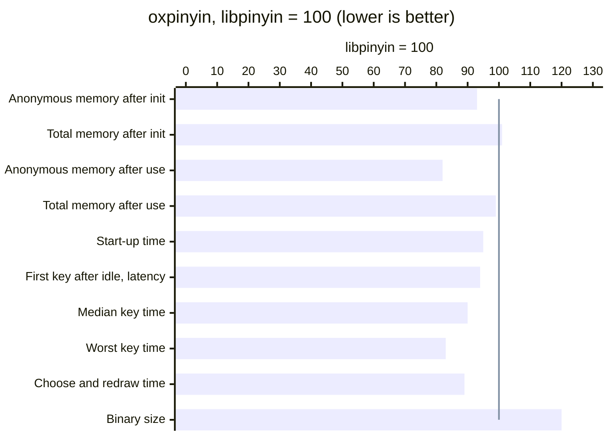

# oxpinyin

oxpinyin is an idiomatic Rust rewrite of libpinyin that aims for close to bug-for-bug compatibility.

中文说明：[README.中文.md](README.中文.md)。

- It is a drop-in replacement for `libpinyin.so.15` (and `libzhuyin.so.15`) on Linux.
- It builds and runs natively on Linux x86_64, macOS arm64 and Windows x86_64 ([setup guide](docs/runbooks/setup.md)).
- In a comparison measured on Linux x86_64 ([docs/performance.md](docs/performance.md)), it uses less CPU and less private memory than libpinyin, about the same total memory, and a larger binary.

Linux x86_64, Kali Rolling on WSL 2. The figures, the other platforms and the method are in [docs/performance.md](docs/performance.md).

oxpinyin is based on [libpinyin](https://github.com/libpinyin/libpinyin), with the frontend ABI from [ibus-libpinyin](https://github.com/libpinyin/ibus-libpinyin).
To contribute, start at [CONTRIBUTING.md](CONTRIBUTING.md); the [roadmap](ROADMAP.md) gives the current stage.

## Licence

GPL-3.0-or-later.
