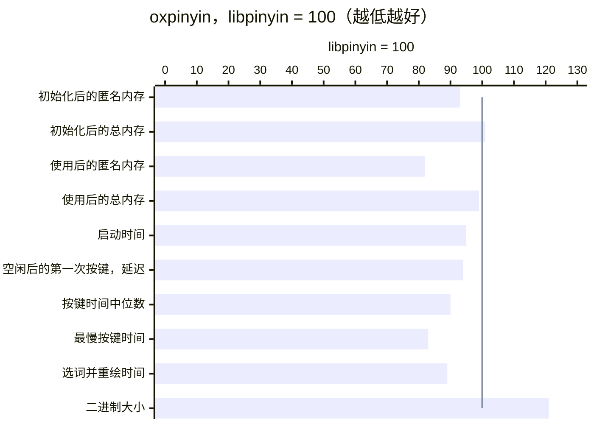

# oxpinyin

oxpinyin 是 libpinyin 的地道 Rust 重写，目标是接近 bug-for-bug 兼容。

English: [README.md](README.md).

- 它在 Linux 上可直接替换 `libpinyin.so.15`（以及 `libzhuyin.so.15`）。
- 它在 Linux x86_64、macOS arm64 和 Windows x86_64 上原生构建并运行（[环境搭建指南](docs/runbooks/setup.md)）。
- 在 Linux x86_64 上测得的对比中（[docs/performance.md](docs/performance.md)），它比 libpinyin 占用更少的 CPU 和私有内存，总内存大致相同，二进制文件更大。

Linux x86_64，WSL 2 上的 Kali Rolling。数据、其他平台与方法见 [docs/performance.md](docs/performance.md)。

oxpinyin 基于 [libpinyin](https://github.com/libpinyin/libpinyin)，前端 ABI 来自 [ibus-libpinyin](https://github.com/libpinyin/ibus-libpinyin)。
参与贡献请从 [CONTRIBUTING.md](CONTRIBUTING.md) 开始；当前阶段见[路线图](ROADMAP.md)。

## 许可证

GPL-3.0-or-later。
